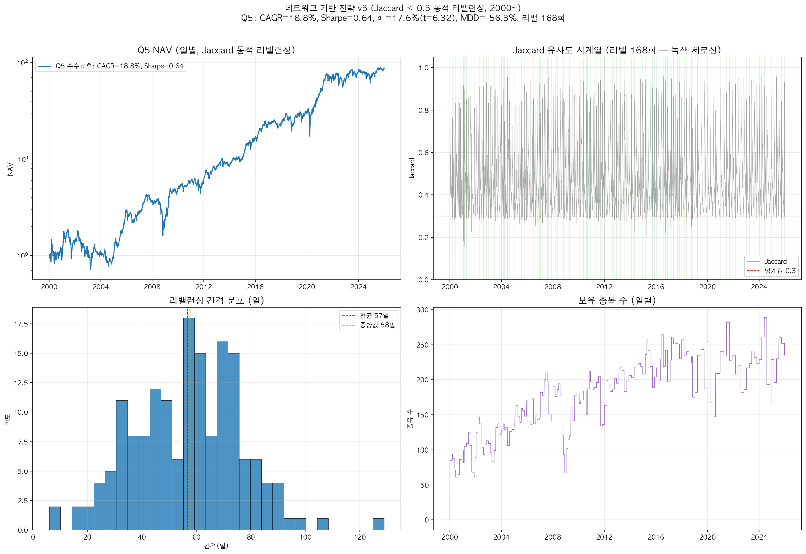

# 상관관계 네트워크 기반 KOSPI/KOSDAQ 퀀트 전략

60일 수익률 상관관계로 종목 네트워크를 만들고, **시장 공통요인(λ1)에 덜 노출되면서 네트워크 중심성이 높은 종목**을 롱온리로 보유하는 전략입니다.
리밸런싱은 고정 주기가 아니라 **보유 종목 구성이 충분히 바뀌었을 때(Jaccard 유사도 ≤ 0.3)만** 실행합니다.



## 성과 요약 (v3, 2000-01 ~ 2025-12, 거래비용 차감 후)

| 지표 | 전략 (Q5) | KOSPI 지수 |
|---|---|---|
| CAGR | **18.8%** | 6.9% |
| 연환산 변동성 | 31.5% | – |
| Sharpe (Rf 2%) | **0.64** | 0.32 |
| MDD (월말 기준) | -56.3% | -49.2% |
| 4팩터 α (연, HAC t값) | **17.6% (t = 6.32)** | – |
| 리밸런싱 횟수 | 168회 (평균 간격 57일) | – |

- 4팩터: MKT, SMB, HML, MOM. 표준오차는 Newey-West HAC(lag 4)입니다.
- KOSPI는 배당을 제외한 가격지수라서 직접 비교할 때 참고만 해 주세요.
- 일별 NAV 기준 MDD는 -62.6%입니다. 2008년과 2020년 3월 낙폭이 큽니다.

## 방법론

매 영업일 *t* 종가 기준으로 계산합니다.

1. **유니버스**: 60일 평균 거래대금 하위 10% 제외, 스팩 제외, 주가 1,000원 미만 제외. 60일 중 결측 없이 수익률이 있는 종목만 사용합니다.
2. **상관 네트워크**: 60일 일간수익률 상관행렬에 **Marchenko–Pastur 클리핑**을 적용해 노이즈 고유값을 제거한 뒤, 음의 상관은 0으로 둔 인접행렬을 만듭니다.
3. **시총 스케일 고유벡터 중심성**: 중심성이 시가총액에 끌려가는 정도(log-log 회귀 기울기)를 매일 추정하고, 그 절반만큼 시총 효과를 보정합니다.
4. **시장요인 노출(λ1 loading)**: 첫 번째 고유벡터의 종목별 적재값입니다.
5. **Composite score** = z(중심성) − *w* · z(λ1 loading). 여기서 *w* = √(λ2/λ1)이고, 시장요인이 강한 국면일수록 λ1 노출 페널티를 키웁니다.
6. **대형주 cutoff**: 시총 상위 √(λ1/Σλ) 비율(최대 80%)을 제외합니다.
7. **Q5 선정**: score 상위 20%를 동일가중으로 보유합니다.
8. **Jaccard 트리거**: 오늘 Q5와 직전 리밸런싱 Q5의 Jaccard 유사도가 0.3 이하일 때만 리밸런싱합니다.
9. **거래비용**: Amihud 비유동성 상위 20% 종목은 0.8%, 나머지는 0.3%를 매매금액에 부과합니다.

수익률은 배당 포함 수정주가로 계산하고, 리밸런싱 다음 영업일부터 반영합니다.

## 버전 히스토리

| 버전 | 파일 | 내용 | 비고 |
|---|---|---|---|
| v1 | `experiments/v1_leadlag_monthly.py` | 사전 계산된 점수 + 리드-래그 entry delay + 월말 Jaccard 판정 | ⚠️ 아래 한계 참고 |
| v2 | `experiments/v2_monthly_2000.py`, `v2_monthly_2010.py` | 점수 계산 파이프라인 내장, 고정 월간 리밸런싱 | 2000~ / 2010~ 표본 |
| **v3** | **`src/strategy_v3_jaccard.py`** | v2 + 일별 점수 계산, Jaccard 동적 리밸런싱 | **최종본** |

**v1의 한계와 v3에서의 수정**

- v1은 월초에 리밸런싱 여부를 정할 때 **그 달 중간**의 Q5 변화까지 봤습니다 (look-ahead). v3는 매일 그날까지의 정보로만 판정하고, 그날 바로 실행합니다.
- v1은 종목별 **전체 기간 분위수**로 월수익률을 윈저라이징한 값을 그대로 손익에 썼습니다. v3는 실제 배당포함 수익률을 그대로 씁니다.
- v1은 월말에야 알 수 있는 거래정지 여부로 종목을 사후에 제외했습니다. v3에서는 제거했습니다.
- v1의 점수 파일(`daily_scores.csv`)과 리드-래그 파일은 외부에서 사전 계산되어 검증이 어려웠습니다. v3는 원천 데이터에서 모든 계산을 직접 수행합니다.

## 남아 있는 한계

- 신호를 계산한 당일 **종가에 체결**한다고 가정합니다. 익일 체결로 바꾸면 성과가 일부 줄어들 수 있습니다.
- 보유 중 수익률이 결측(거래정지·상장폐지)이면 0%로 처리합니다. 상장폐지 손실이 반영되지 않아 결과가 다소 낙관적입니다.
- 롱온리라서 시장 하락 국면의 낙폭(MDD)이 큽니다.

## 폴더 구조

```
├── src/
│   ├── strategy_v3_jaccard.py   # 최종 전략 백테스트
│   └── generate_data.py         # 대시보드용 JSON 생성 (v2 월간 로직)
├── experiments/                 # 이전 버전 (v1, v2)
├── results/                     # v3 결과: 그래프, 일별 NAV, 리밸런싱 로그
├── docs/                        # 웹 대시보드 (GitHub Pages)
└── data/                        # 원본 데이터 위치 (저장소에는 미포함)
```

## 실행 방법

```bash
pip install -r requirements.txt
# data/README.md에 적힌 CSV를 data/ 폴더에 넣은 뒤
python src/strategy_v3_jaccard.py   # → results/ 에 그래프·NAV·로그 저장
python src/generate_data.py         # → docs/strategy_data.json 갱신
```

첫 실행 때 CSV를 parquet으로 캐시(`data/.cache_parquet/`)하므로, 두 번째 실행부터는 로딩이 빨라집니다.
그래프의 한글 폰트는 macOS의 `AppleGothic`을 쓰도록 설정되어 있습니다.

## 대시보드

`docs/`의 정적 페이지가 `strategy_data.json`을 읽어 최신 월말 기준 보유 종목, 분위별 누적수익률, 성과 지표를 보여줍니다.
대시보드 데이터는 **v2(월간 리밸런싱) 로직**으로 생성되므로, 수치가 위의 v3 표와 조금 다릅니다.
로컬에서 보려면 `cd docs && python -m http.server` 후 `http://localhost:8000`에 접속하세요.
